<p align="center"></p>

<h1 align="center">Quarters</h1>

<p align="center">
  <a href="https://github.com/amithgc/quarters/releases/latest"></a>
  <a href="LICENSE"></a>
  <a href="https://github.com/amithgc/quarters/actions/workflows/ci.yml"></a>
  
  <a href="#install"></a>
</p>

<p align="center"><b>A minimalist home for terminal coding agents, for developers who work on many projects at once.</b><br>
Claude Code, Codex, Gemini CLI, Antigravity, OpenCode, Copilot CLI, Devin or Aider: switch projects in a click,<br>
run your agents in several of them side by side, see what they're doing,<br>
start your dev servers with one action — and do it all from your phone, too.</p>

<p align="center">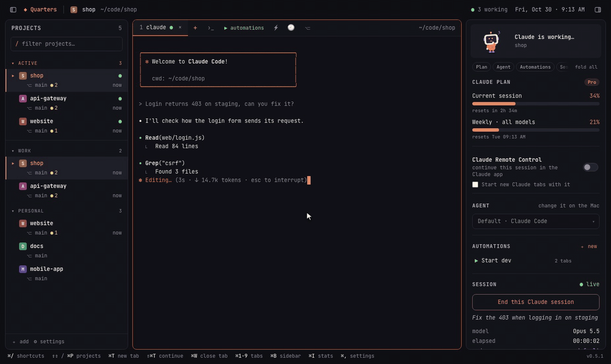</p>

```sh
brew install --cask amithgc/tap/quarters
```

<p align="center"><sub>Free and open source · <a href="https://quarters.amithgc.com">quarters.amithgc.com</a> · If Quarters saves you some tab-hunting, a ⭐ helps other developers find it.</sub></p>

<p align="center">
  <a href="#install">Install</a> ·
  <a href="#features">Features</a> ·
  <a href="#coding-agents">Coding agents</a> ·
  <a href="#remote-access-work-from-anywhere">Remote access</a> ·
  <a href="#configuration">Configuration</a> ·
  <a href="#faq">FAQ</a> ·
  <a href="CONTRIBUTING.md">Contributing</a>
</p>

<p align="center"></p>

## Why Quarters

If you use a terminal coding agent — [Claude Code](https://docs.anthropic.com/en/docs/claude-code),
Codex, Gemini CLI, Antigravity, OpenCode — on more than one project, you know
the routine: a terminal window per project, `cd` into each one, start the
agent, start the backend, start the frontend, then remember which window was
waiting for you.

**Quarters is a simple, focused home for your coding agents that takes that
routine away.** Pick the agent you like (Claude Code is the default, and each
project can use a different one). Its goals are deliberately narrow:

1. **Switch between projects instantly.** Every project is one click (or
   ⌘P) away; its agent sessions keep running in the background while you're
   elsewhere.
2. **Work on several projects at the same time.** Agents run in as many
   projects as you like, and Quarters tells you which one finished and is
   waiting for you.
3. **See what's going on at a glance.** A side panel shows git changes, the
   project's automations and servers, and what the agent tells Quarters: for
   Claude Code the session's model, context and tokens, your plan's usage,
   what it edited, and the project's MCP servers and skills; for Antigravity
   its plan and model quotas.
4. **Start the rest of your stack in one go.** *Automations* open the
   terminals a project needs — backend, frontend, a script, a watcher — each
   in its own folder, side by side, when you open the project, on a
   schedule or with one click.
5. **Do the daily chores where you work.** Commit, push and open pull
   requests (with CI status), run a project's scripts, stop the dev server
   holding a port, undo an agent turn that went wrong, search every project
   at once, and copy a summary of your day.
6. **Work from anywhere.** Leave Quarters running on your big machine at
   home and use it from a laptop, tablet or phone through the browser: the
   same projects, the same live sessions, secured with passkeys.

It is built **for developers and their coding agents, and nothing else**: no
general-purpose terminal features, no AI of its own, no accounts or cloud
services. Your projects, your logins and your machine stay yours.

> Quarters is an independent open-source project. It is not made by,
> affiliated with or endorsed by Anthropic, OpenAI, Google, GitHub or the
> makers of the other agents it runs. Claude and Claude Code are trademarks
> of Anthropic; the other names are trademarks of their owners.

## Features

### Home: every project at a glance

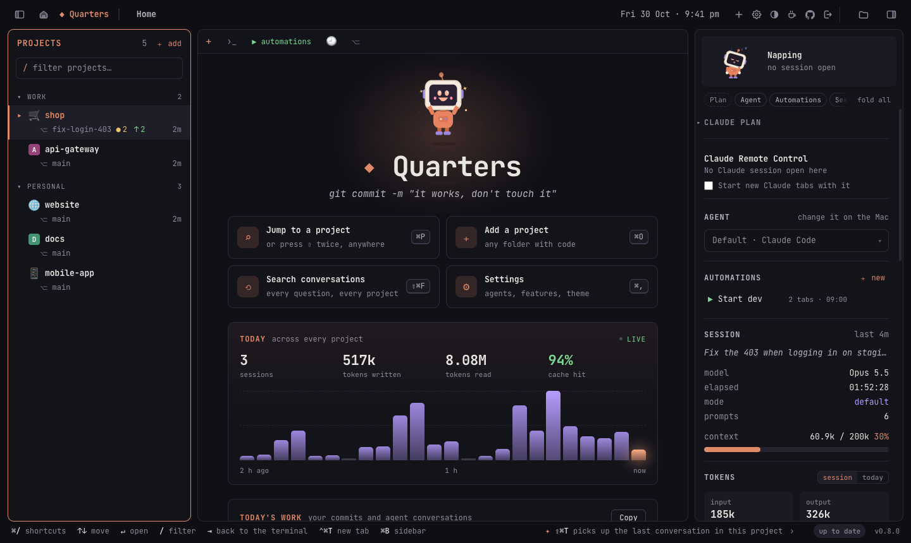

The house at the left of the title bar (or **Home** in ⇧⌘P) shows the home
page, with your tabs still running behind it:

- **Jump to a project, add one, search conversations, Settings:** one tile
  each, with its shortcut. A different tagline greets you every time.
- **Today, across every project:** sessions, tokens written and read, and
  the cache hit rate, with the last two hours as an animated chart (bars
  rise in, the current five minutes glow; hover one for its time and
  tokens).
- **Today's work:** per project, your commits since midnight, the agent
  conversations you had and how many prompts, and what isn't committed yet.
  **Copy** puts it on the clipboard as Markdown, for a standup or a
  timesheet (also ⇧⌘P → *Copy today's summary*).
- **Active now:** every running session, the ones waiting for you first.

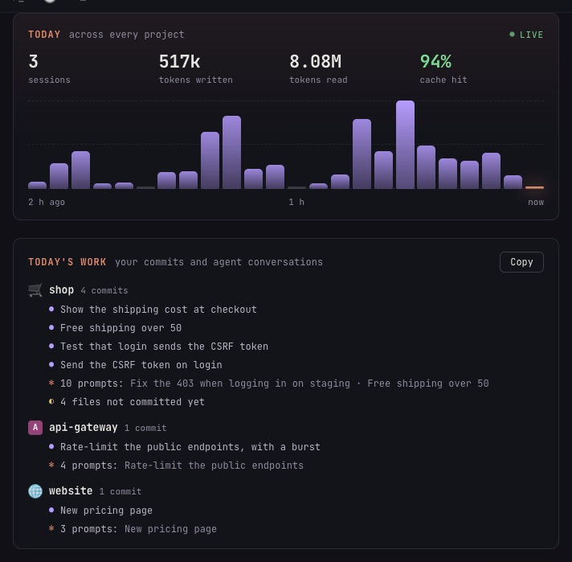

### Projects, tabs and sessions

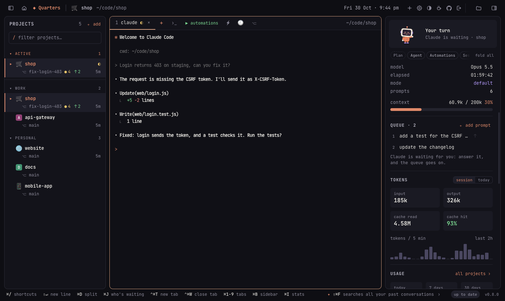

- **One click** opens a project; press **C** to start its coding agent,
  **⇧C** to continue the last conversation, **S** for a shell.
- **Several tabs per project** (agents and shells), all running in the
  background while you switch.
- **Images in the terminal:** a path to an image an agent made (or any
  PNG, JPEG, GIF or WebP a tab prints) is a link: hover to preview it,
  click to see it full screen.
- **"Your turn" alerts:** when an agent finishes in a tab you aren't looking
  at, you get a notification and a Dock badge, and the tab is marked.
- **Who's waiting for you:** the ACTIVE list (with 5 projects or more)
  puts the sessions that finished (or are asking you something) first,
  longest waiting first, with how long; **⌘J** (or a click on "◐ waiting" in the title bar) goes to the
  next one.
- **Prompt queue:** line up prompts for a session ("add tests", then "fix
  lint"…); each goes in when the agent finishes the one before, never over
  a question it is asking or a message you started typing. On a phone, ⏭
  in the message card queues what you typed while the agent works.
- Groups, project icons, drag to reorder, **⌘P / ⇧⇧** to jump anywhere,
  git status (●changes ↑ahead ↓behind) in the list, and **＋ add** in the
  list's header.
- **Project icons:** an image (favicons and app icons in the folder are
  suggested), or any emoji from **Emoji…**, every emoji there is, by group
  and with a search by name.
- **A colour per project** on its tabs and the terminal's frame, so you
  can tell projects apart at a glance (from its name, or one you pick).
- **Every command by name:** **⇧⌘P** (or `>` in the jump list).
- **Focus mode:** **⇧⌘↵** leaves only the terminal; again brings the
  panels back.
- **Tips:** one quiet line at the bottom right about a key or a panel, the
  ones you haven't used first. The next one fades in every two minutes;
  › shows it now.
- **Saved prompts** (⚡): type a common instruction with one click.
- **The project's automations in the side panel:** run, restart or stop
  each one, edit it, delete it, or add a new one, right where you work.
- **Any of twelve coding agents,** chosen for all projects or per project
  (see [Coding agents](#coding-agents)).

### Split panes and a files panel

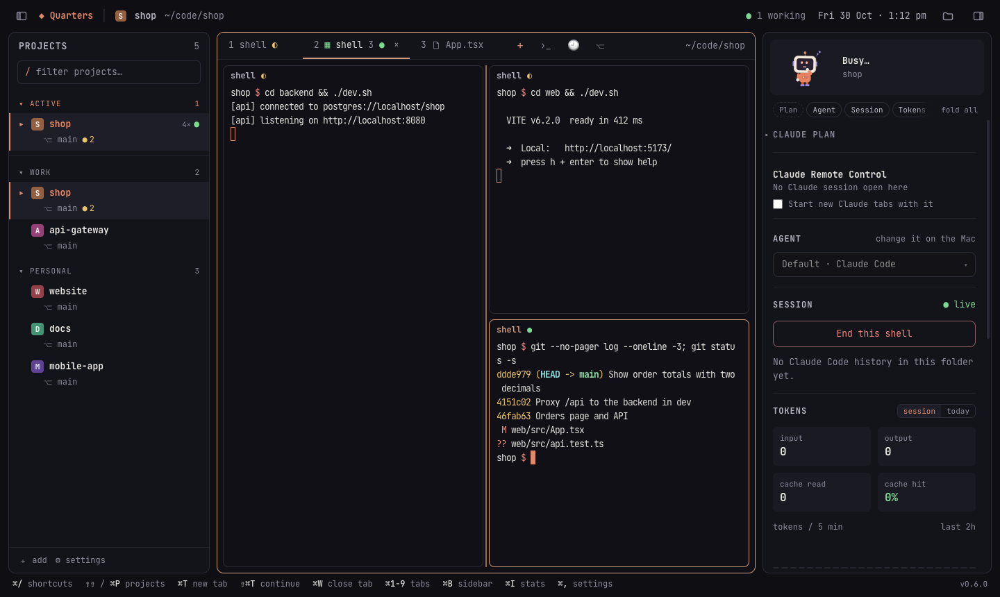

- **Split panes, as in iTerm:** **⌘D** opens a shell beside the one you're
  in, **⇧⌘D** one below it, and splits nest. **⌘[** and **⌘]** move between
  panes, **⌘W** closes just the pane, and a pane whose shell exits cleanly
  closes by itself. Drag the line between two panes to resize them
  (double-click to make them equal). Another window or device shows the
  same panes.
- **A files panel** (**⇧⌘E**, or the folder in the title bar, which glows
  while it's open): the project's folders and files with git's marks
  (changed, new, ignored), and a box that finds any file in the project.
  Right-click a file to copy its path, type it in the terminal, open it
  with its app or show it in Finder.
- **A small editor for quick fixes:** click a file to open it in a tab
  beside the terminals, with syntax colours for about 30 languages, search
  (⌘F) and **⌘S** to save. When an agent edits the same file, the editor
  follows it; a save never overwrites a change made since you opened the
  file (you choose to reload or keep yours). Files that may hold keys or
  passwords (`.env`, `*.pem`…) are never opened.

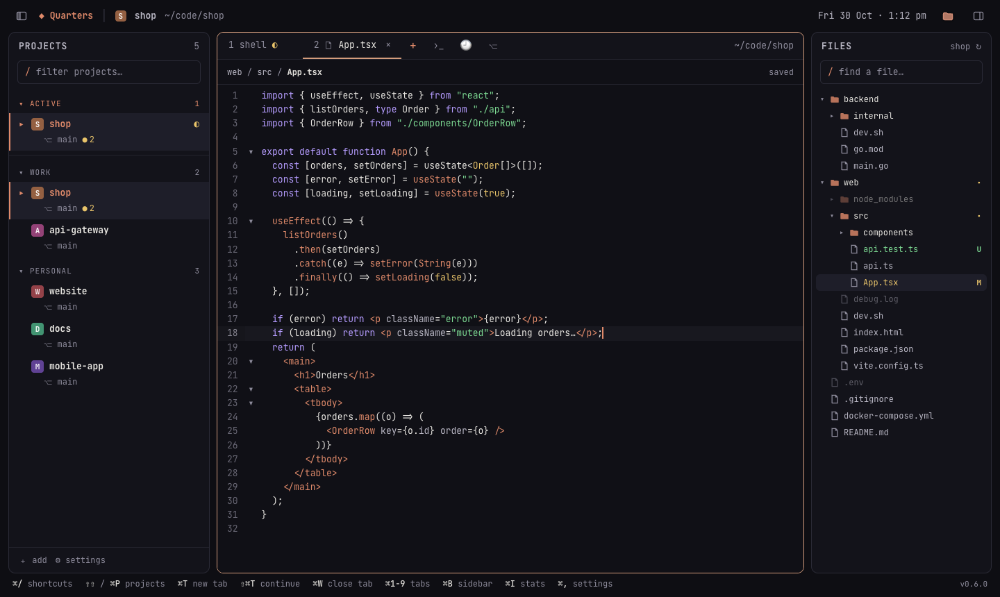

### Everyday developer tools

The chores around an agent's work, without leaving the project.

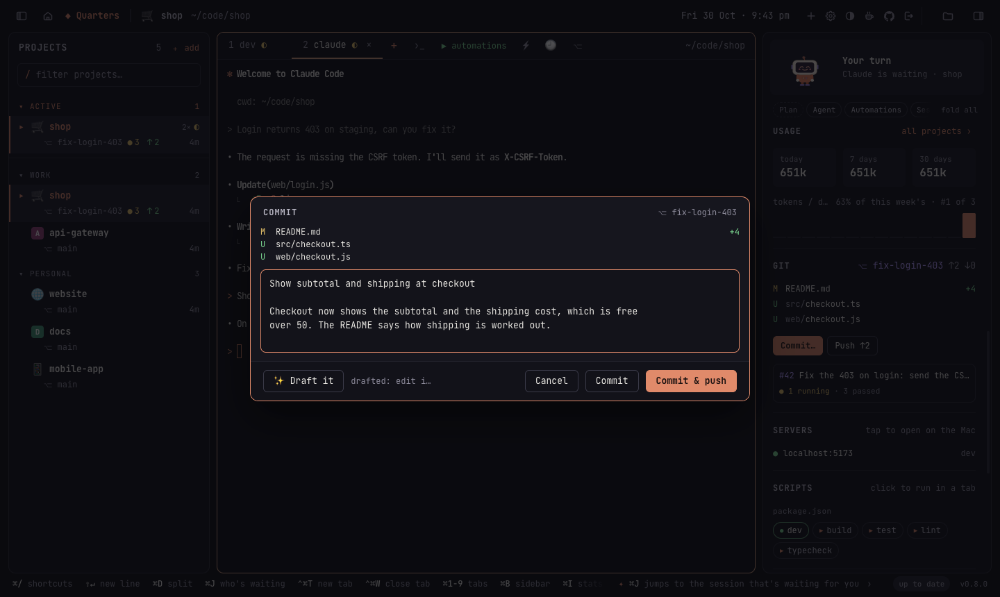

- **Commit, push and pull requests:** **Commit…** under the changed files in
  the side panel's GIT section opens a dialog with the files and a message
  box; **✨ Draft it** asks Claude Code (`claude -p`) to write the message
  from the diff, in the style of your recent commits, and nothing is
  committed until you click. **Commit & push** does both; **Push ↑2** pushes
  what's ahead (setting the upstream the first time); **Open a pull
  request** runs `gh pr create --fill`. Files that look like they hold
  secrets (`.env`, keys…) are never committed: the commit stops and names
  them.
- **CI at a glance:** the branch's pull request shows under the files with
  its checks: ✓ passed, ● running, ✕ failed (and which). It's read with the
  GitHub CLI (`gh`), about once a minute.
- **Scripts, one click away:** the SCRIPTS section lists what the project
  knows how to run: `package.json` scripts (with pnpm, yarn, bun or npm,
  from the lockfile), `Makefile` targets, `justfile` recipes, `deno.json`
  tasks, and Cargo and Go commands. A click runs one in a tab of its own; a
  running one is marked and goes to its tab. In ⇧⌘P, `run dev` runs it too.
- **Ports:** the PORTS section lists what the project's tabs are listening
  on (`:5173 node · web`), and other processes of yours working in its
  folder. **open** opens it in the browser, **tab** goes to the tab that
  started it, **stop** ends it ("port 3000 is already in use", solved).
- **Checkpoints before every prompt:** each time you send an agent a
  prompt, Quarters quietly snapshots the project's files (everything git
  doesn't ignore, committed or not). The CHECKPOINTS section lists them with
  what changed after each; open one to see every file's diff since, and
  **restore** to put the files back as they were. Restoring takes a
  checkpoint first, so it can be undone too. Your branch, index and stash
  are never touched: checkpoints are commits kept under
  `refs/quarters/checkpoints/`, the last 50 per project, and a plain
  `git push` doesn't send them anywhere.

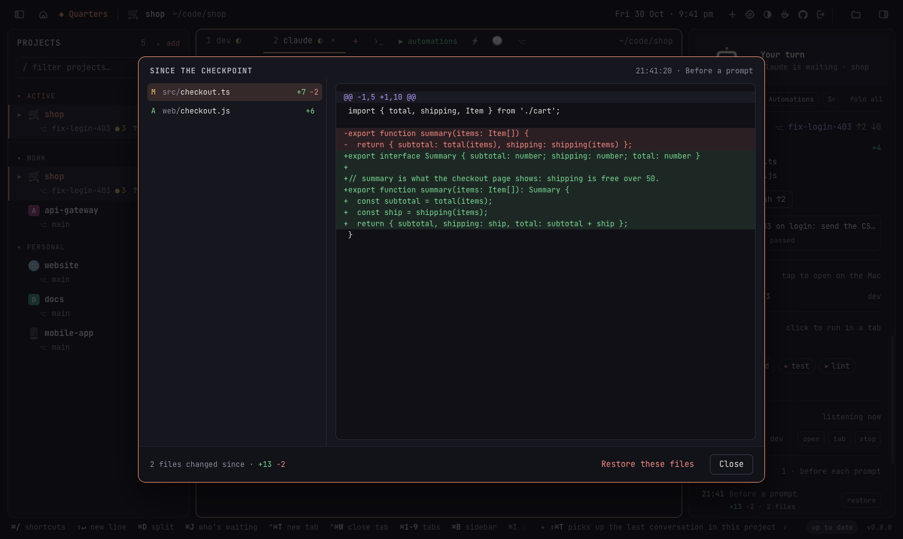

- **Clickable errors:** `src/cart.ts:42:7` (or `file.py:12`, `File
  "x.py", line 3`, `Foo.cs(10,5)`) in any terminal is a link when the file
  is in the project: **⌘-click** opens it in the editor at that line.
- **Send to agent:** select output in a terminal, or lines in the editor,
  and press **⇧⌘L** (or the button that appears): it's typed into the
  project's agent tab, with the file and line numbers from the editor, but
  not sent, so you can say what to do with it.

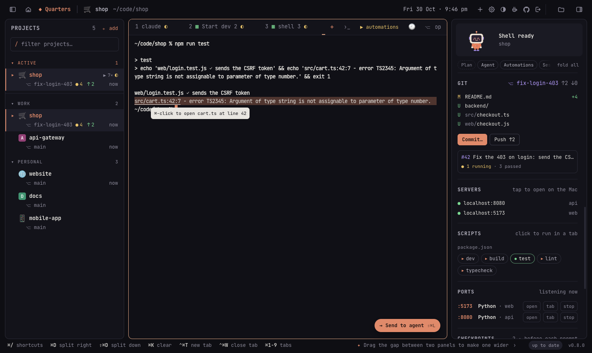

- **Search every project** (**⇧⌘K**): one box searches the files of all
  your projects at once, with ripgrep when it's installed (git grep
  otherwise). Match case, whole words, regular expressions and a file
  filter (`*.go`); results by project and file, and Enter opens the file at
  the line. Files that may hold secrets are never searched.

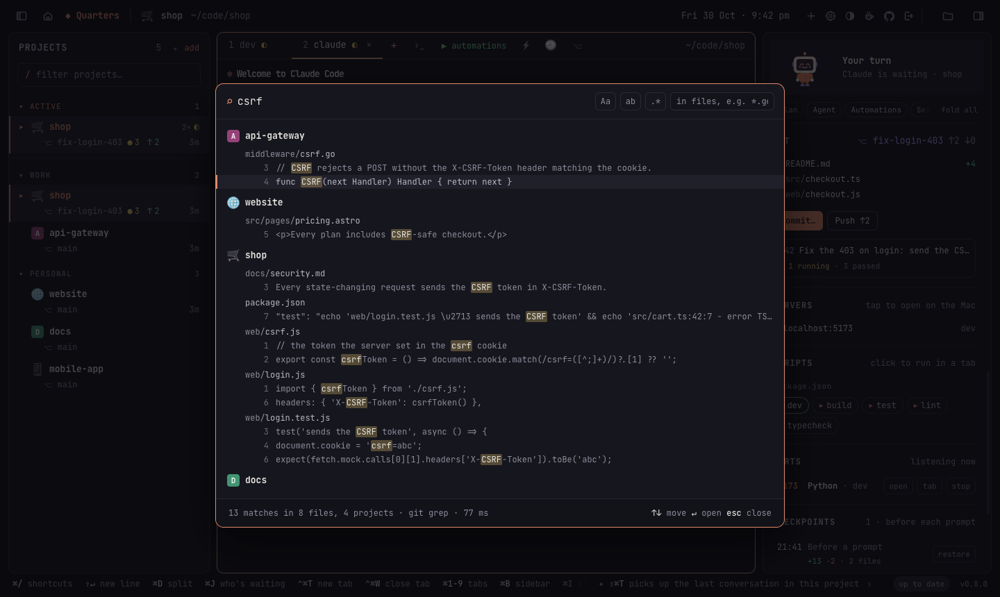

### Coding agents

Choose the default in **Settings → Coding agent**, and per project from the
side panel's **Agent** menu (or ✎ on the project). Agents that aren't
installed are marked, and starting one tells you where to get it.

| Agent | Starts | Continue (⇧C) | Skip permission prompts (yolo) | Side panel |
| --- | --- | --- | --- | --- |
| Claude Code (default) | `claude` | `--continue` | `--dangerously-skip-permissions` | everything below |
| Codex | `codex` | `resume --last` | `--dangerously-bypass-approvals-and-sandbox` | git, automations |
| Gemini CLI | `gemini` | `--resume latest` | `--yolo` | git, automations |
| Antigravity | `agy` | `--continue` | `--dangerously-skip-permissions` | plan and model quotas¹, git, automations |
| OpenCode | `opencode` | `--continue` | — (set in its own config) | git, automations |
| GitHub Copilot CLI | `copilot` | `--continue` | `--allow-all-tools` | git, automations |
| Devin | `devin` | `--continue` | `--permission-mode bypass` | git, automations |
| Aider | `aider` | `--restore-chat-history` | `--yes-always` | git, automations |
| Amp | `amp` | `threads continue --last` | `--dangerously-allow-all` | git, automations |
| Goose | `goose` | `session --resume` | — (`GOOSE_MODE=auto` in its config) | git, automations |
| Qwen Code | `qwen` | `--continue` | `--yolo` | git, automations |
| Cursor CLI | `agent` | `--continue` | `--force` | git, automations |

Claude Code gets the deepest integration, because Quarters reads its session
logs: session stats, plan usage, past conversations, the phone's chat view
and Remote Control. Other agents run as they are, in their terminal (on a
phone with the same message card as Claude), with everything else Quarters does — tabs, alerts, automations, worktrees, git,
remote access — working the same.

¹ Read from the Antigravity IDE while it's open on the same machine, through
its local (unofficial) interface; nothing leaves the machine.

### Automations: your dev stack in one action


An automation opens a set of terminals, each in its own folder and running
its own command, arranged as a grid, side by side, stacked or as tabs. Run it
by hand (▶), when the project opens, or on a schedule (every weekday at
09:00, say). Servers your terminals start show up in the side panel with
whether they're answering.

### The side panel: what your agent is doing

<table>
<tr>
<td width="34%"></td>
<td>

- **Plan:** Claude's usage limits and when they reset, as `/usage` shows
  them, with a warning before you run out (Antigravity: its plan and model
  quotas).
- **Agent** and **Automations:** the project's coding agent, and its
  automations with run, stop, edit, delete and ＋ new.
- **Session:** title, model, permission mode, prompts, context window use,
  tokens (this session or today) and activity.
- **Git:** branch, ahead/behind, changed files, **Commit…**, **Push** and
  **Open a pull request**, and the pull request's checks.
- **Claude changed:** the files Claude edited this session; click one for its
  diff.
- **Servers:** `localhost` links your terminals printed, up or down.
- **Scripts** and **Ports:** the project's scripts to run in a tab, and
  what its tabs listen on, to open or stop.
- **Checkpoints:** a snapshot before each prompt, to diff against or
  restore.
- **Usage:** the project's tokens today, over 7 and 30 days, and its share
  of yours; **⇧⌘U** ranks every project (from Claude Code's logs).
- **Instructions:** edit the project's `CLAUDE.md`, `AGENTS.md`,
  `GEMINI.md` or `CONVENTIONS.md` (the one its agent reads is offered even
  before it exists), and your own notes on the project, kept by Quarters
  outside the project folder.
- Click a section's title to fold it to one line; the bar above the panel
  jumps to a section or folds them all. Each device remembers its own.
- **Tools, MCP servers and skills** available in the project.
- **Claude Remote Control:** a switch that starts new Claude tabs with
  Claude Code's own Remote Control, so you can also continue them from
  claude.ai/code and the Claude app.

</td>
</tr>
</table>


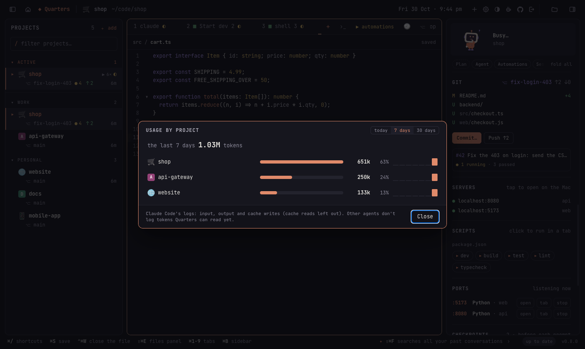

### Past conversations, restarts and worktrees


- **Search past conversations** (🕘 / ⇧⌘F): everything you and Claude said in
  a project; open one to resume it.
- **Pick up where you left off:** after a restart (or a crash), Quarters
  offers to reopen every conversation and automation that was running.
- **Git worktrees** (⎇ / ⇧⌘G): start Claude on a separate copy of the
  project, on its own branch, so several can work on the same repository
  without stepping on each other.

### Settings: switch off what you don't need


Every optional feature has a switch (checkpoints, scripts and ports among
them), and Claude's permission mode can be set globally or per project. **Appearance** picks light, dark or the
system's look, on each device.

### Remote access: work from anywhere

<table>
<tr>
<td width="30%"></td>
<td>

Run Quarters on the machine that has your code (a desktop at home, a Mac
mini in a cupboard) and use it from any browser: your laptop on the road,
an iPad, your phone. You see the **same live sessions**: start Claude on the
Mac, answer it from your phone, finish on the laptop.

- On a phone, every coding agent gets the same session view: its
  transcript above, and a message card below (the one place to type, with
  ↑ send, ■ stop and the tab tools), the same for Claude Code, Codex and
  the rest. Claude Code's transcript reads like the Claude app: a chat with
  your messages, its replies, folded tool rows, the images it sends and
  buttons for its questions (▤ shows the terminal). Other agents show their terminal.
- Installs as an app on your phone's home screen, with a key bar for the
  keys a phone lacks (esc, tab, ⇧tab, ctrl, arrows) and saved prompts.
- **Phone alerts** when Claude is waiting, even with the app closed.
- **Passkeys** (Face ID / Touch ID) to sign in. Devices can only be paired
  from the Mac, and each device can be limited to *type only* or *watch only*.
- Start and stop the server from the app (⌥⌘R).

</td>
</tr>
</table>


## Install

**Requirements:** macOS 11 or later (or Linux, or Windows through WSL, for the server, below), and at least one coding agent
installed and signed in, on your `PATH`: [Claude Code](https://docs.anthropic.com/en/docs/claude-code)
(`claude`, the default) or one of the [others](#coding-agents). Quarters is developed and
tested on current macOS on Apple silicon; the app is universal (Apple
silicon and Intel).

With [Homebrew](https://brew.sh):

```sh
brew install --cask amithgc/tap/quarters
```

The app is signed with a Developer ID and notarized by Apple, so it opens
like any other. `brew update && brew upgrade --cask quarters` updates it.
You can also download the zip from the
[releases](https://github.com/amithgc/quarters/releases).

### Building from source

You need Go 1.26+, Node.js 20+ and the [Wails](https://wails.io) CLI:

```sh
go install github.com/wailsapp/wails/v2/cmd/wails@v2.17.0

git clone https://github.com/amithgc/quarters && cd quarters
make install        # builds Quarters.app and copies it to /Applications
```

`make build` builds it into `build/bin/Quarters.app` without installing. For
an Intel Mac use `wails build -platform darwin/amd64`. A build of your own is
signed ad hoc, so the first time macOS may ask you to confirm opening it
(right-click → Open).

**Releasing** (maintainers): `scripts/release.sh 1.2.3` publishes a version
from a Mac: it signs and notarizes the app, publishes the GitHub release and
updates the Homebrew tap. Its header lists the one-time setup.

### Linux: the server, used from a browser

On Linux, Quarters runs as a server with no window: leave it on the machine
that has your code (a home server, a big desktop, a box in a cupboard) and
use it from a browser or the phone app. Everything the browser version does
works: projects, Claude and shell tabs, automations, the chat view on
phones, plan usage, past conversations and worktrees. The Mac-only extras
(the window, the Dock badge, the global hotkey) are left out.

It is a single file with no dependencies besides your coding agent and git.
Install it with Homebrew on Linux (`brew install amithgc/tap/quarters-server`),
download it from the [releases](https://github.com/amithgc/quarters/releases)
(`quarters-linux-amd64.tar.gz` or `-arm64`), or build it (on any machine)
and copy it over:

```sh
git clone https://github.com/amithgc/quarters && cd quarters
make server          # build/bin/quarters-linux-amd64 and quarters-linux-arm64
scp build/bin/quarters-linux-amd64 my-server:/usr/local/bin/quarters
```

Then, on the server:

```sh
quarters --set-password amith   # the username and password to sign in with
quarters                        # start the server (it prints its addresses and a pairing link)
```

Add your projects from the browser (＋ add) once signed in, or list them in
`~/.config/quarters/config.json`. To open it on your home network, set
`"remote": {"lan": true}` there; to reach it from anywhere, put a tunnel in
front (see [Remote access setup](#remote-access-setup)). Plan usage is read
from `~/.claude/.credentials.json`, where Claude Code keeps its login on
Linux.

Managing it without a window:

| command | does |
| --- | --- |
| `quarters --set-password NAME` | set (or change) the username and password; signed-in browsers sign in again |
| `quarters --pair` | a one-time link that pairs a device with a passkey (HTTPS or `localhost` only) |
| `quarters --devices` | list the paired devices and the password sign-in |
| `quarters --remove-device NAME` | unpair a device (by name or id); it is signed out at once |
| `quarters --version` | which Quarters this is, e.g. `Quarters 0.7.0 (linux/amd64, server)`; worth adding to a bug report |
| `quarters --help` | all of the above |

To keep it running, a systemd user service works well:

```ini
# ~/.config/systemd/user/quarters.service
[Unit]
Description=Quarters

[Service]
ExecStart=/usr/local/bin/quarters
Restart=on-failure

[Install]
WantedBy=default.target
```

```sh
systemctl --user enable --now quarters
loginctl enable-linger $USER    # keep it running when you're logged out
```

### Docker: the server in a container

The [`docker/`](docker) folder has a `Dockerfile` and a `compose.yaml` that
run the Linux server with Claude Code inside, as a normal user (Claude Code
won't skip its permission prompts as root). Your projects live in a folder
you mount, and settings, sign-ins and conversations in a volume, so they
survive updates.

```sh
git clone https://github.com/amithgc/quarters && cd quarters/docker
mkdir -p code                       # your projects go here (or set CODE_DIR=/path/to/code)
docker compose build
docker compose run --rm quarters quarters --set-password amith   # username and password
docker compose up -d
```

Open `http://localhost:8421` (or `http://<the machine's IP>:8421` from
another device on your network) and sign in. Then:

1. **Sign Claude Code in, once:** `docker compose exec quarters claude`,
   then `/login`; it prints a link to open in any browser and asks for the
   code it shows. The login stays in the volume.
2. **Add projects** from the browser (＋ add): folders under `code/` are at
   `/home/dev/code/…` in the container. To clone one there:
   `docker compose exec quarters git clone https://github.com/you/app code/app`.
3. **Git:** set your name and email once
   (`docker compose exec quarters git config --global user.name "You"`, and
   `user.email`), or mount your `~/.gitconfig`; mount `~/.ssh` to push over
   SSH (both are in `compose.yaml`, commented out).

Good to know:

- **Your user id:** files Quarters writes in `code/` belong to user 1000. If
  your id (`id -u`) is different, build with
  `QUARTERS_UID=$(id -u) docker compose build`.
- **Ports:** keep both numbers in `"8421:8421"` the same; the server checks
  the address it is reached at.
- **Changing the password:** run the `--set-password` line again, then
  `docker compose restart`.
- **The home network only:** the container answers plain HTTP from private
  addresses (your network, Tailscale), never from the internet. For HTTPS and
  passkeys, put a tunnel in front: set `QUARTERS_URL` in `compose.yaml` to its
  address (e.g. `https://quarters.example.com`) before the first start, and
  point the tunnel at `http://localhost:8421` (`cloudflared tunnel run --url
  http://localhost:8421 quarters`, or `tailscale serve --bg 8421`). If the
  settings already exist, add `"url"` under `"remote"` in
  `~/.config/quarters/config.json` (`docker compose exec quarters vi …`, or
  edit it in the browser) and restart.
- **Other agents:** install them in the image (add a `RUN` line to the
  `Dockerfile`, e.g. `npm i -g @openai/codex` after adding Node.js).
- **Updating:** change `QUARTERS_VERSION` in `compose.yaml`, then
  `docker compose up -d --build`. Claude Code updates itself.

### Windows: the server in WSL

On Windows, run the Linux server inside [WSL](https://learn.microsoft.com/windows/wsl/install)
(`wsl --install` in an administrator PowerShell, then open Ubuntu), with
Claude Code and your projects in WSL too. Follow the Linux steps above inside
Ubuntu, start `quarters`, and open `http://localhost:8421` in Edge or Chrome
on Windows: WSL passes `localhost` through, so passkeys (Windows Hello) and
installing it as an app work. To reach it from a phone, turn on WSL's
mirrored networking and the home network. The
[install guide](https://quarters.amithgc.com/docs#install-windows) has every
step.

## Getting started

1. Open Quarters. The first time, it lists the folders you used Claude Code
   in most recently (if you use it). Add others with **＋ add** (⌘O). If your projects are in
   Documents, Desktop or on an external drive, macOS asks whether Quarters
   may access them: allow it, or the project list stays empty.
2. Click a project and press **C**. Its coding agent (Claude Code unless
   you chose another in Settings) starts in that folder.
3. Add an automation for your dev servers: right-click the project →
   **Automations** → **＋ Add automation**.
4. **⌘,** opens Settings. **Projects → Remote Access…** sets up remote use.

### Keyboard shortcuts

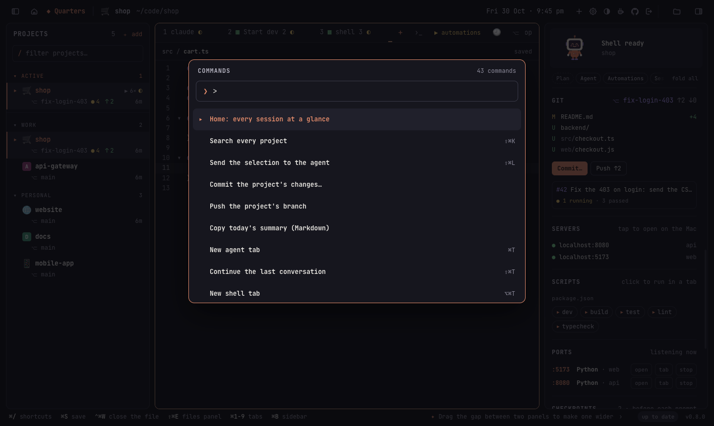

| keys | action |
| --- | --- |
| ⌘/ | all keyboard shortcuts (Help → Keyboard Shortcuts) |
| click, then **C** / **⇧C** / **S** | open a project, then start Claude / continue / a shell |
| ⌘P or ⇧⇧ (tap Shift twice) | jump to a project or automation |
| ⇧⌘P | every command, by name |
| ⌘T / ⇧⌘T / ⌥⌘T | new Claude tab / continue last conversation / shell tab |
| ⌘W | close tab (in a split: the pane) |
| ⌘1–9, ⇧⌘[ ⇧⌘] | switch tabs |
| ⌘D / ⇧⌘D | split: a shell beside / below this one (⌘[ ⌘] switch panes) |
| ⌘J | go to the session waiting for you longest |
| ⌘B / ⌘I | show or hide projects / side panel |
| ⇧⌘E | show or hide the files panel; a click opens a file in an editor tab, ⌘S saves |
| ⇧⌘↵ | focus mode: only the terminal |
| ⌘O | add a project |
| ⌘, / ⌥⌘, | Settings / edit config.json |
| ⇧⌘F / ⇧⌘G | search past conversations / worktrees |
| ⇧⌘K | search every project's files |
| ⇧⌘L | send the selection (terminal or editor) to the agent |
| ⌘-click a `file:line` | open it in the editor at that line |
| ⇧⌘U | usage by project |
| ⌥⌘R | start or stop the remote-access server |
| ⌃⌥Space (from any app) | bring Quarters forward, or hide it |
| ⌘= / ⌘- / ⌘0 | text size |
| ⌘K | clear the terminal |

Also: **Shift+Enter** adds a new line in Claude Code; drop files on a
terminal to type their paths; hover `[Image #N]` to see a pasted image;
double-click a tab to rename it. Light and dark mode follow macOS, or pick
one in Settings → Appearance (each device keeps its own).

## Remote access setup

Remote access is **off until you start it**, and it gives whoever signs in a
shell on your Mac. Read [SECURITY.md](SECURITY.md) for how it is protected.
In short, Quarters only listens on `127.0.0.1`, and you choose the tunnel
that gives it a public HTTPS address.

1. Give the Mac an HTTPS address with a tunnel. With Cloudflare and your own
   domain:

   ```sh
   brew install cloudflared
   cloudflared tunnel login
   cloudflared tunnel create quarters
   cloudflared tunnel route dns quarters quarters.example.com
   cloudflared tunnel run --url http://127.0.0.1:8421 quarters
   ```

   Or with Tailscale: `tailscale funnel 8421`, then use the
   `https://….ts.net` address it prints.
2. In Quarters, **Projects → Remote Access…**: enter
   `https://quarters.example.com` and press **Start server**.
3. **Pair a device…** and scan the QR code with your phone. It creates a
   passkey on the phone.
4. On the phone, add the page to the home screen. From then on, open it and
   sign in with Face ID.

**No tunnel?** Leave the public URL empty and press **Start server**: Quarters
is then at `http://localhost:8421`, which another computer can reach through
SSH (`ssh -L 8421:localhost:8421 your-mac`, then open
`http://localhost:8421` and the pairing link there). Phones need the tunnel.

**At home, without a tunnel:** turn on **Home network** in Remote Access and
set a **username and password** there. Phones and computers on the same Wi-Fi
then open `http://<the Mac's IP>:8421` (the dialog shows the addresses and a
QR code) and sign in with the password, since passkeys don't work on a plain
IP address. The connection isn't encrypted, so keep it to networks you trust.
iPhones can add it to the home screen as is. Android's Chrome installs web
apps only from secure addresses, so on the home network tell it to trust
this one, once: in `chrome://flags/#unsafely-treat-insecure-origin-as-secure`
enter the address (e.g. `http://192.168.1.20:8421`), set it to Enabled and
relaunch; then ⋮ → Install app. The sign-in page shows these steps on
Android.

For a Mac with no screen, `Quarters.app/Contents/MacOS/Quarters --serve`
runs only the server (it uses the same settings and prints a pairing link);
the commands in [Linux](#linux-the-server-used-from-a-browser) (`--set-password`,
`--pair`, `--devices`, `--remove-device`) work there too.

## Configuration

Settings and projects live in `~/.config/quarters/config.json`. Most of it is
edited from the app, but you can also edit the file (⌥⌘,): on the Mac in
your text editor, in a browser in Quarters' own editor, which won't save a
mistake or a change to remote access. Quarters picks up changes within
seconds, and tells you if the file has a mistake without ever overwriting
it.

```json
{
  "projects": [
    { "name": "Shop", "path": "~/code/shop", "group": "Work", "icon": "web/favicon.svg",
      "automations": [
        { "name": "Start dev", "layout": "columns", "auto": true,
          "schedule": { "at": "09:00", "days": ["mon", "tue", "wed", "thu", "fri"] },
          "tabs": [
            { "name": "api", "dir": "backend", "command": "npm run dev" },
            { "name": "web", "dir": "web",     "command": "npm run dev" },
            { "name": "shell" }
          ] }
      ] },
    { "path": "~/code/api-gateway", "group": "Work", "command": ["claude", "--model", "sonnet"], "yolo": false },
    { "path": "~/code/ml", "harness": "codex" }
  ],
  "yolo": true,
  "shell": "/bin/zsh"
}
```

| field | meaning |
| --- | --- |
| `projects[].path` | project folder (`~` allowed); required |
| `projects[].name` | label in the list (default: the folder name) |
| `projects[].group` | heading to group projects under |
| `projects[].icon` | image next to the project (png, jpg, svg, ico, webp; relative = inside the project), or an emoji, e.g. `"🚀"` |
| `projects[].color` | colour of its tabs and terminal frame: `#rrggbb` or `accent` (default: from its name) |
| `projects[].harness` | the coding agent for this project, overriding `harness` |
| `projects[].command` | how the project's agent starts in this project |
| `projects[].yolo` | `true`/`false`: skip the agent's permission prompts here, overriding `yolo` |
| `projects[].automations` | terminals to start together (see below) |
| `harness` | the coding agent new tabs start: `claude` (default), `codex`, `gemini`, `antigravity`, `opencode`, `copilot`, `devin`, `aider`, `amp`, `goose`, `qwen` or `cursor` |
| `command` | how Claude Code starts (default `["claude"]`) |
| `yolo` | skip the agent's permission prompts (default `true`; see below) |
| `shell` | shell for shell tabs (default `$SHELL`) |
| `prompts` | saved prompts for ⚡ (edited in Settings) |
| `features` | optional features switched on or off (Settings), e.g. `{"checkpoints": false}` |
| `hotkey` | global hotkey, e.g. `ctrl+alt+space` |
| `usage_alert_at` | warn when a plan limit passes this percentage (default 80) |
| `context_window` | tokens; 0 = read from Claude Code's model setting |
| `remote` | remote access (set in the app) |
| `layout` | panel widths and folded groups, saved as you change them |

**Automations:** `layout` is `grid` (default), `columns`, `rows` (all
terminals as panes of one tab, resizable) or `tabs`. `dir` is relative to the
project. `command` is typed into a login shell once it's ready, so Ctrl+C
leaves you in that shell and ↑ runs it again. `auto` runs it when you open the
project. `schedule` runs it by itself once a day, unless it's already
running.

> **About `yolo`.** By default Claude Code runs with
> `--dangerously-skip-permissions`, so it edits files and runs commands
> without asking. That's convenient in your own projects and risky anywhere
> else. Turn it off in Settings, or per project.
>
> Other agents get their own switch: Codex
> `--dangerously-bypass-approvals-and-sandbox`, Gemini CLI `--yolo`,
> Antigravity `--dangerously-skip-permissions`, Copilot CLI
> `--allow-all-tools`, Devin `--permission-mode bypass`, Aider `--yes-always`,
> Amp `--dangerously-allow-all`, Qwen Code `--yolo`, Cursor CLI `--force`
> (OpenCode and Goose have none; set it in their own config). "Continue"
> runs `codex resume --last`, `gemini --resume latest`, `agy --continue`,
> `opencode --continue`, `copilot --continue`, `devin --continue`,
> `aider --restore-chat-history`, `amp threads continue --last`,
> `goose session --resume`, `qwen --continue` or `agent --continue`.

## How it works

Quarters is a [Wails](https://wails.io) app: a Go backend with a plain
JavaScript frontend in the system WebView.

- Each session runs in a pseudo-terminal on the Go side (`internal/session`),
  and [xterm.js](https://xtermjs.org) draws it. Every window, the Mac's and
  any browser's, shows the same sessions; whichever one you're typing in
  sets the terminal's size.
- Each coding agent is a program started in a pseudo-terminal with its own
  switches (`internal/config/harness.go`).
- The side panel reads Claude Code's own session logs in `~/.claude/projects`
  (`internal/stats`). Plan usage comes from the endpoint `/usage` uses, with
  the login Claude Code keeps in the Keychain, which is only ever sent to
  Anthropic.
- The developer tools run your own programs: `git` for commits and
  checkpoints (snapshots go through a temporary index, so yours is never
  touched), `gh` for pull requests and checks, `claude -p` for a drafted
  commit message, `lsof` (or `ss`) for ports, and `rg` (or `git grep`) for
  search.
- Remote access (`internal/remote`) is an HTTP server with passkey
  (WebAuthn) sign-in and a WebSocket carrying the same calls and events the
  Mac window uses.
- Idle, it stays out of the way: git runs only when something may have
  changed, files are read again only when they change, the project list is
  pushed to windows when it changes, and nothing on a timer runs while the
  window is hidden. Measured on a Mac with 14 projects, idle in the
  background: about 2% of one CPU core.

```
main.go, app.go, …     the app: window, menus, the functions the frontend calls
internal/config        config.json
internal/projects      the project list and icons
internal/session       pseudo-terminals
internal/stats         Claude Code logs, git, plan usage (Claude, Antigravity), conversations, skills
internal/remote        remote access: passkeys, sessions, WebSocket, push
frontend/dist          the frontend (plain ES modules, no bundler; ui/ holds the dialogs, loaded when first opened)
tools/mascot           draws the mascot
```

## FAQ

**How is this different from tmux?**
tmux can hold all the sessions, and with enough scripts it can do much of
the rest. Quarters is what those scripts would add up to, without writing
them: a list of your projects with their git status, an agent started in one
key, a mark on the session that finished and is waiting for you (⌘J goes to
it), a side panel with the session's model, context, tokens, plan usage and
the files the agent changed, automations that start the dev servers with
the project, and the same live sessions in a phone's browser, signed in with
a passkey. If you live in tmux and like it there, keep it; Quarters is for
people who'd rather click a project than remember a session name.

**Why not tabs in iTerm2, Ghostty, Warp or the Terminal?**
A terminal knows about shells, not projects or agents. Tabs don't tell you
which agent is done, can't start a project's backend and frontend together,
and can't be picked up from your phone. Quarters keeps one place per project
(its agent tabs, shells and servers) and leaves the general terminal work
to your terminal.

**What about apps that run many agents on one repository?**
Several tools run a team of agents in parallel worktrees of a single
repository. Quarters starts from the other end: many projects, each with
the agent and the dev stack it needs, and quick switching between them. It
does worktrees too (⎇), when you want several agents on one repository.

**Is it an editor?**
No. The files panel and its editor are for a look or a quick fix (a
config value, a line the agent got wrong) without leaving the project.
Keep your editor for real work; Quarters follows its changes on the disk
the same way it follows the agent's.

**Does my code or my prompts go anywhere?**
No. Quarters has no AI of its own, no accounts and no analytics. It starts
the agents you installed, with their own logins, and they talk to their
providers as they always do. Remote access is off until you start it, and
then it only listens on this Mac (see [SECURITY.md](SECURITY.md)).

**Does ✨ Draft it send my code anywhere?**
Only when you click it: it runs your own Claude Code (`claude -p`) with the
diff of the commit (files that look like they hold secrets left out), the
same as asking it in a terminal, and uses your plan the same way.

**Where do checkpoints live, and do they get pushed?**
In the project's own git repository, as commits under
`refs/quarters/checkpoints/` (the last 50). They aren't on any branch, so
`git push` doesn't send them; `git for-each-ref refs/quarters` lists them,
and switching Checkpoints off in Settings stops new ones.

**Does it work with my Claude subscription or API key?**
Yes: it runs `claude` (or another agent) exactly as you would in a
terminal, signed in however you signed it in.

**Do sessions keep running when I quit Quarters?**
No, the agents run inside Quarters. When it starts again, it offers to
reopen the conversations and automations that were open, and Claude Code
picks each conversation up where it left off. To keep agents running while
you're away, leave Quarters running on that machine (or run the
[server](#linux-the-server-used-from-a-browser) on a Linux box) and use it
from a browser.

## Contributing

Contributions are welcome. See [CONTRIBUTING.md](CONTRIBUTING.md) for setup
and guidelines:

```sh
make dev       # run with live reload
make test      # go test -race ./...
make lint      # gofmt, go vet, staticcheck
```

Please report security problems privately, as described in
[SECURITY.md](SECURITY.md).

## Credits

Built with [Wails](https://wails.io), [xterm.js](https://xtermjs.org),
[JetBrains Mono](https://www.jetbrains.com/lp/mono/),
[go-webauthn](https://github.com/go-webauthn/webauthn) and the other
libraries in [THIRD_PARTY_NOTICES.md](THIRD_PARTY_NOTICES.md). The mascot is
original to Quarters.

<p align="center">
  
  
  
  
  
  
</p>

## License

[MIT](LICENSE) © 2026 Amith
