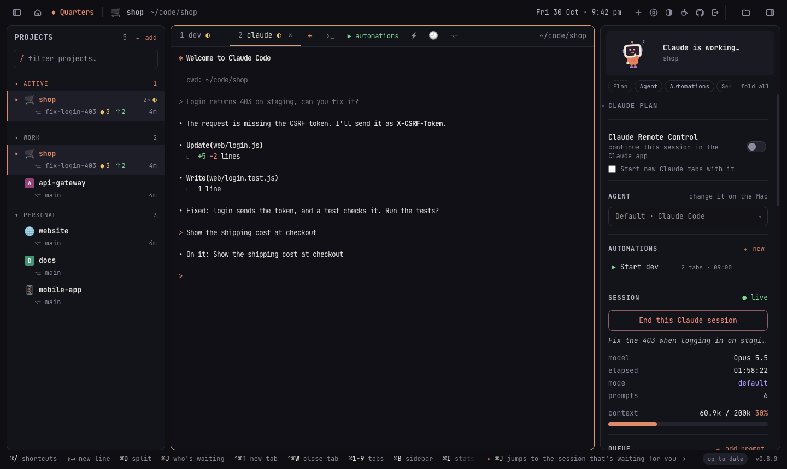
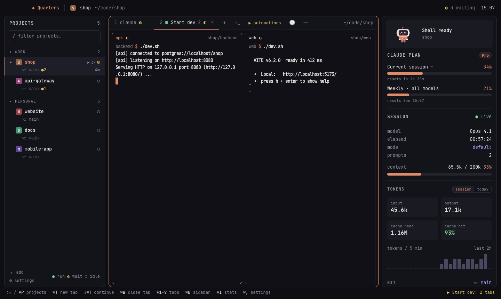
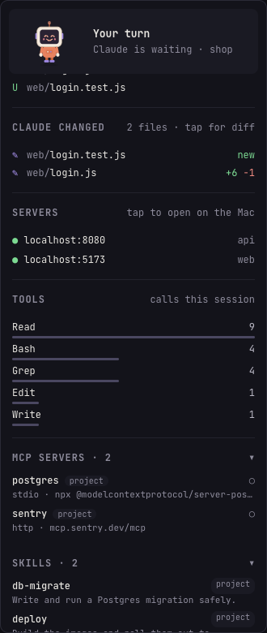
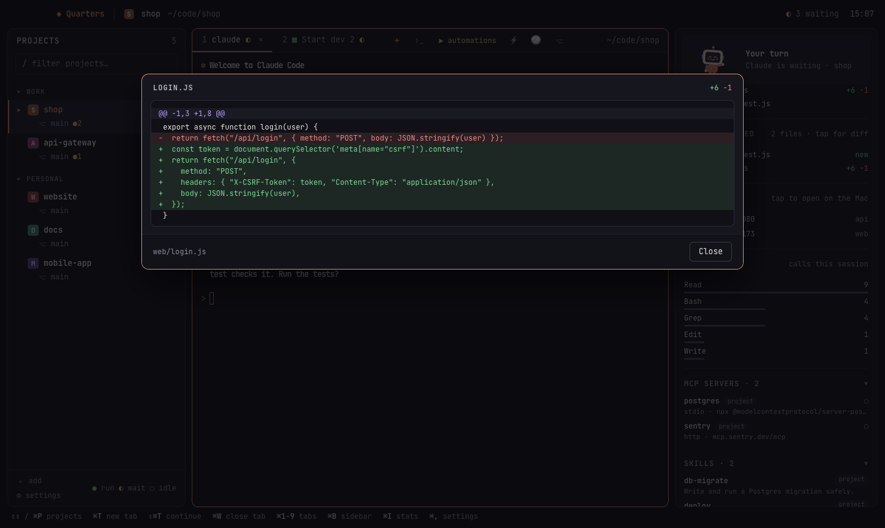
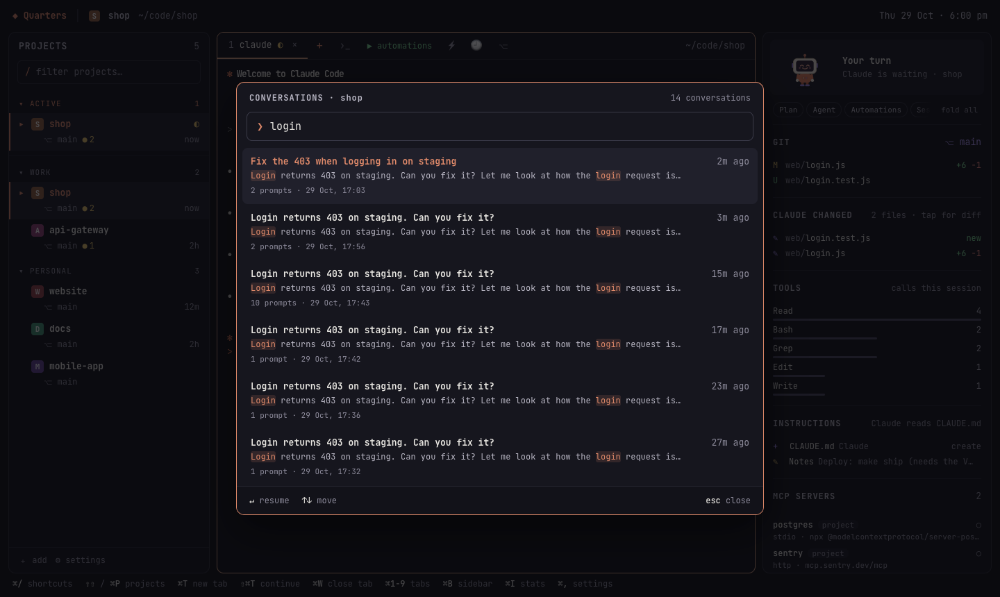
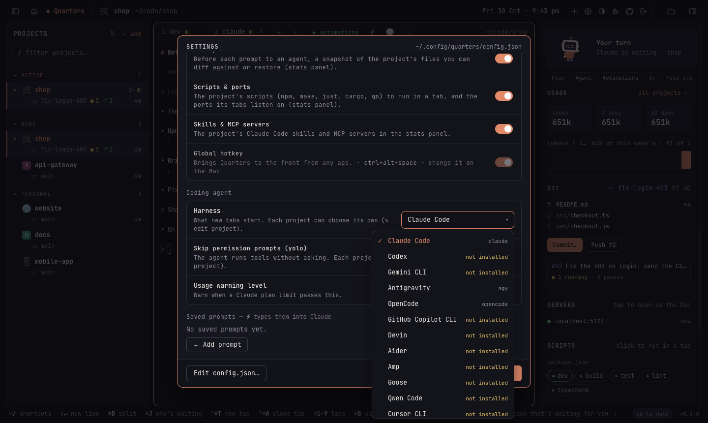
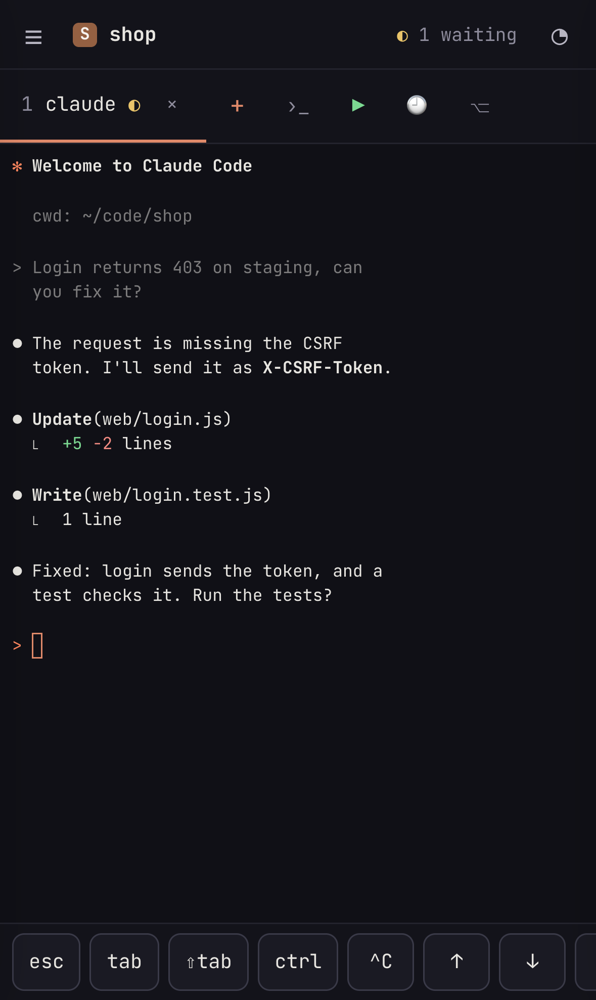
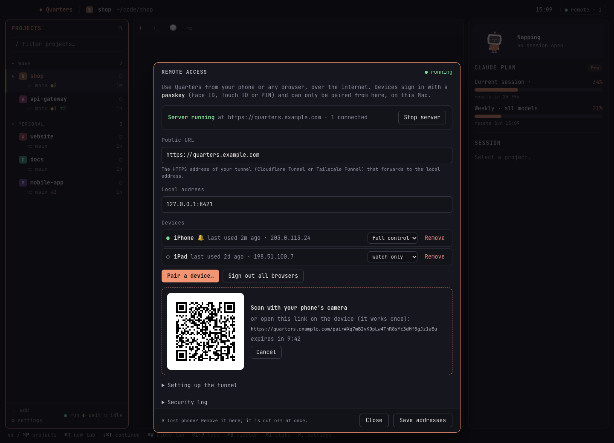

<p align="center"></p>

<h1 align="center">Quarters</h1>

<p align="center"><b>A minimalist home for terminal coding agents, for developers who work on many projects at once.</b><br>
Claude Code, Codex, Gemini CLI, Antigravity, OpenCode, Copilot CLI, Devin or Aider: switch projects in a click,<br>
run your agents in several of them side by side, see what they're doing,<br>
start your dev servers with one action — and do it all from your phone, too.</p>

<p align="center">
  <a href="#install">Install</a> ·
  <a href="#features">Features</a> ·
  <a href="#coding-agents">Coding agents</a> ·
  <a href="#remote-access-work-from-anywhere">Remote access</a> ·
  <a href="#configuration">Configuration</a> ·
  <a href="CONTRIBUTING.md">Contributing</a>
</p>

<p align="center"></p>

## Why Quarters

If you use a terminal coding agent — [Claude Code](https://docs.anthropic.com/en/docs/claude-code),
Codex, Gemini CLI, Antigravity, OpenCode — on more than one project, you know
the routine: a terminal window per project, `cd` into each one, start the
agent, start the backend, start the frontend, then remember which window was
waiting for you.

**Quarters is a simple, focused home for your coding agents that takes that
routine away.** Pick the agent you like (Claude Code is the default, and each
project can use a different one). Its goals are deliberately narrow:

1. **Switch between projects instantly.** Every project is one click (or
   ⌘P) away; its agent sessions keep running in the background while you're
   elsewhere.
2. **Work on several projects at the same time.** Agents run in as many
   projects as you like, and Quarters tells you which one finished and is
   waiting for you.
3. **See what's going on at a glance.** A side panel shows git changes, the
   project's automations and servers, and what the agent tells Quarters: for
   Claude Code the session's model, context and tokens, your plan's usage,
   what it edited, and the project's MCP servers and skills; for Antigravity
   its plan and model quotas.
4. **Start the rest of your stack in one go.** *Automations* open the
   terminals a project needs — backend, frontend, a script, a watcher — each
   in its own folder, side by side, when you open the project, on a
   schedule or with one click.
5. **Work from anywhere.** Leave Quarters running on your big machine at
   home and use it from a laptop, tablet or phone through the browser: the
   same projects, the same live sessions, secured with passkeys.

It is built **for developers and their coding agents, and nothing else**: no
general-purpose terminal features, no AI of its own, no accounts or cloud
services. Your projects, your logins and your machine stay yours.

> Quarters is an independent open-source project. It is not made by,
> affiliated with or endorsed by Anthropic, OpenAI, Google, GitHub or the
> makers of the other agents it runs. Claude and Claude Code are trademarks
> of Anthropic; the other names are trademarks of their owners.

## Features

### Projects, tabs and sessions

- **One click** opens a project; press **C** to start its coding agent,
  **⇧C** to continue the last conversation, **S** for a shell.
- **Several tabs per project** (agents and shells), all running in the
  background while you switch.
- **"Your turn" alerts:** when an agent finishes in a tab you aren't looking
  at, you get a notification and a Dock badge, and the tab is marked.
- Groups, project icons (favicons found automatically), drag to reorder,
  **⌘P / ⇧⇧** to jump anywhere, git status (●changes ↑ahead ↓behind) in the
  list.
- **Saved prompts** (⚡): type a common instruction with one click.
- **The project's automations in the side panel:** run, restart or stop
  each one, edit it, delete it, or add a new one, right where you work.
- **Any of eight coding agents,** chosen for all projects or per project
  (see [Coding agents](#coding-agents)).

### Coding agents

Choose the default in **Settings → Coding agent**, and per project from the
side panel's **Agent** menu (or ✎ on the project). Agents that aren't
installed are marked, and starting one tells you where to get it.

| Agent | Starts | Continue (⇧C) | Skip permission prompts (yolo) | Side panel |
| --- | --- | --- | --- | --- |
| Claude Code (default) | `claude` | `--continue` | `--dangerously-skip-permissions` | everything below |
| Codex | `codex` | `resume --last` | `--dangerously-bypass-approvals-and-sandbox` | git, automations |
| Gemini CLI | `gemini` | `--resume latest` | `--yolo` | git, automations |
| Antigravity | `agy` | `--continue` | `--dangerously-skip-permissions` | plan and model quotas¹, git, automations |
| OpenCode | `opencode` | `--continue` | — (set in its own config) | git, automations |
| GitHub Copilot CLI | `copilot` | `--continue` | `--allow-all-tools` | git, automations |
| Devin | `devin` | `--continue` | `--permission-mode bypass` | git, automations |
| Aider | `aider` | `--restore-chat-history` | `--yes-always` | git, automations |

Claude Code gets the deepest integration, because Quarters reads its session
logs: session stats, plan usage, past conversations, the phone's chat view
and Remote Control. Other agents run as they are, in a plain terminal, with
everything else Quarters does — tabs, alerts, automations, worktrees, git,
remote access — working the same.

¹ Read from the Antigravity IDE while it's open on the same machine, through
its local (unofficial) interface; nothing leaves the machine.

### Automations: your dev stack in one action



An automation opens a set of terminals, each in its own folder and running
its own command, arranged as a grid, side by side, stacked or as tabs. Run it
by hand (▶), when the project opens, or on a schedule (every weekday at
09:00, say). Servers your terminals start show up in the side panel with
whether they're answering.

### The side panel: what your agent is doing

<table>
<tr>
<td width="34%"></td>
<td>

- **Plan:** Claude's usage limits and when they reset, as `/usage` shows
  them, with a warning before you run out (Antigravity: its plan and model
  quotas).
- **Agent** and **Automations:** the project's coding agent, and its
  automations with run, stop, edit, delete and ＋ new.
- **Session:** title, model, permission mode, prompts, context window use,
  tokens (this session or today) and activity.
- **Git:** branch, ahead/behind, changed files.
- **Claude changed:** the files Claude edited this session; click one for its
  diff.
- **Servers:** `localhost` links your terminals printed, up or down.
- **Tools, MCP servers and skills** available in the project.
- **Claude Remote Control:** a switch that starts new Claude tabs with
  Claude Code's own Remote Control, so you can also continue them from
  claude.ai/code and the Claude app.

</td>
</tr>
</table>



### Past conversations, restarts and worktrees



- **Search past conversations** (🕘 / ⇧⌘F): everything you and Claude said in
  a project; open one to resume it.
- **Pick up where you left off:** after a restart (or a crash), Quarters
  offers to reopen every conversation and automation that was running.
- **Git worktrees** (⎇ / ⇧⌘G): start Claude on a separate copy of the
  project, on its own branch, so several can work on the same repository
  without stepping on each other.

### Settings: switch off what you don't need



Every optional feature has a switch, and Claude's permission mode can be
set globally or per project.

### Remote access: work from anywhere

<table>
<tr>
<td width="30%"></td>
<td>

Run Quarters on the machine that has your code (a desktop at home, a Mac
mini in a cupboard) and use it from any browser: your laptop on the road,
an iPad, your phone. You see the **same live sessions**: start Claude on the
Mac, answer it from your phone, finish on the laptop.

- On a phone, Claude tabs read like the Claude app: a chat with your
  messages, Claude's replies, folded tool rows and buttons for Claude's
  questions (▤ shows the terminal).
- Installs as an app on your phone's home screen, with a key bar for the
  keys a phone lacks (esc, tab, ⇧tab, ctrl, arrows) and saved prompts.
- **Phone alerts** when Claude is waiting, even with the app closed.
- **Passkeys** (Face ID / Touch ID) to sign in. Devices can only be paired
  from the Mac, and each device can be limited to *type only* or *watch only*.
- Start and stop the server from the app (⌥⌘R).

</td>
</tr>
</table>



## Install

**Requirements:** macOS 11 or later (or Linux, or Windows through WSL, for the server, below), and at least one coding agent
installed and signed in, on your `PATH`: [Claude Code](https://docs.anthropic.com/en/docs/claude-code)
(`claude`, the default) or one of the [others](#coding-agents). Quarters is developed and
tested on current macOS on Apple silicon; Intel builds should work but are
untested.

There are no signed downloads yet, so build it from source. You need Go
1.26+, Node.js 20+ and the [Wails](https://wails.io) CLI:

```sh
go install github.com/wailsapp/wails/v2/cmd/wails@v2.17.0

git clone https://github.com/amithgc/quarters && cd quarters
make install        # builds Quarters.app and copies it to /Applications
```

`make build` builds it into `build/bin/Quarters.app` without installing. For
an Intel Mac use `wails build -platform darwin/amd64`. The app is signed ad
hoc, so the first time macOS may ask you to confirm opening it
(right-click → Open).

### Linux: the server, used from a browser

On Linux, Quarters runs as a server with no window: leave it on the machine
that has your code (a home server, a big desktop, a box in a cupboard) and
use it from a browser or the phone app. Everything the browser version does
works: projects, Claude and shell tabs, automations, the chat view on
phones, plan usage, past conversations and worktrees. The Mac-only extras
(the window, the Dock badge, the global hotkey) are left out.

It is a single file with no dependencies besides Claude Code and git. Build
it (on any machine, for `amd64` and `arm64`) and copy it over:

```sh
git clone https://github.com/amithgc/quarters && cd quarters
make server          # build/bin/quarters-linux-amd64 and quarters-linux-arm64
scp build/bin/quarters-linux-amd64 my-server:/usr/local/bin/quarters
```

Then, on the server:

```sh
quarters --set-password amith   # the username and password to sign in with
quarters                        # start the server (it prints its addresses and a pairing link)
```

Add your projects from the browser (＋ add) once signed in, or list them in
`~/.config/quarters/config.json`. To open it on your home network, set
`"remote": {"lan": true}` there; to reach it from anywhere, put a tunnel in
front (see [Remote access setup](#remote-access-setup)). Plan usage is read
from `~/.claude/.credentials.json`, where Claude Code keeps its login on
Linux.

Managing it without a window:

| command | does |
| --- | --- |
| `quarters --set-password NAME` | set (or change) the username and password; signed-in browsers sign in again |
| `quarters --pair` | a one-time link that pairs a device with a passkey (HTTPS or `localhost` only) |
| `quarters --devices` | list the paired devices and the password sign-in |
| `quarters --remove-device NAME` | unpair a device (by name or id); it is signed out at once |
| `quarters --help` | all of the above |

To keep it running, a systemd user service works well:

```ini
# ~/.config/systemd/user/quarters.service
[Unit]
Description=Quarters

[Service]
ExecStart=/usr/local/bin/quarters
Restart=on-failure

[Install]
WantedBy=default.target
```

```sh
systemctl --user enable --now quarters
loginctl enable-linger $USER    # keep it running when you're logged out
```

### Windows: the server in WSL

On Windows, run the Linux server inside [WSL](https://learn.microsoft.com/windows/wsl/install)
(`wsl --install` in an administrator PowerShell, then open Ubuntu), with
Claude Code and your projects in WSL too. Follow the Linux steps above inside
Ubuntu, start `quarters`, and open `http://localhost:8421` in Edge or Chrome
on Windows: WSL passes `localhost` through, so passkeys (Windows Hello) and
installing it as an app work. To reach it from a phone, turn on WSL's
mirrored networking and the home network. The
[install guide](https://quarters.amithgc.com/docs#install-windows) has every
step.

## Getting started

1. Open Quarters. The first time, it lists the folders you used Claude Code
   in most recently (if you use it). Add others with **＋ add** (⌘O). If your projects are in
   Documents, Desktop or on an external drive, macOS asks whether Quarters
   may access them: allow it, or the project list stays empty.
2. Click a project and press **C**. Its coding agent (Claude Code unless
   you chose another in Settings) starts in that folder.
3. Add an automation for your dev servers: right-click the project →
   **Automations** → **＋ Add automation**.
4. **⌘,** opens Settings. **Projects → Remote Access…** sets up remote use.

### Keyboard shortcuts

| keys | action |
| --- | --- |
| ⌘/ | all keyboard shortcuts (Help → Keyboard Shortcuts) |
| click, then **C** / **⇧C** / **S** | open a project, then start Claude / continue / a shell |
| ⌘P or ⇧⇧ (tap Shift twice) | jump to a project or automation |
| ⌘T / ⇧⌘T / ⌥⌘T | new Claude tab / continue last conversation / shell tab |
| ⌘W | close tab |
| ⌘1–9, ⇧⌘[ ⇧⌘] | switch tabs |
| ⌘B / ⌘I | show or hide projects / side panel |
| ⌘O | add a project |
| ⌘, / ⌥⌘, | Settings / edit config.json |
| ⇧⌘F / ⇧⌘G | search past conversations / worktrees |
| ⌥⌘R | start or stop the remote-access server |
| ⌃⌥Space (from any app) | bring Quarters forward, or hide it |
| ⌘= / ⌘- / ⌘0 | text size |
| ⌘K | clear the terminal |

Also: **Shift+Enter** adds a new line in Claude Code; drop files on a
terminal to type their paths; hover `[Image #N]` to see a pasted image;
double-click a tab to rename it. Light and dark mode follow macOS.

## Remote access setup

Remote access is **off until you start it**, and it gives whoever signs in a
shell on your Mac. Read [SECURITY.md](SECURITY.md) for how it is protected.
In short, Quarters only listens on `127.0.0.1`, and you choose the tunnel
that gives it a public HTTPS address.

1. Give the Mac an HTTPS address with a tunnel. With Cloudflare and your own
   domain:

   ```sh
   brew install cloudflared
   cloudflared tunnel login
   cloudflared tunnel create quarters
   cloudflared tunnel route dns quarters quarters.example.com
   cloudflared tunnel run --url http://127.0.0.1:8421 quarters
   ```

   Or with Tailscale: `tailscale funnel 8421`, then use the
   `https://….ts.net` address it prints.
2. In Quarters, **Projects → Remote Access…**: enter
   `https://quarters.example.com` and press **Start server**.
3. **Pair a device…** and scan the QR code with your phone. It creates a
   passkey on the phone.
4. On the phone, add the page to the home screen. From then on, open it and
   sign in with Face ID.

**No tunnel?** Leave the public URL empty and press **Start server**: Quarters
is then at `http://localhost:8421`, which another computer can reach through
SSH (`ssh -L 8421:localhost:8421 your-mac`, then open
`http://localhost:8421` and the pairing link there). Phones need the tunnel.

**At home, without a tunnel:** turn on **Home network** in Remote Access and
set a **username and password** there. Phones and computers on the same Wi-Fi
then open `http://<the Mac's IP>:8421` (the dialog shows the addresses and a
QR code) and sign in with the password, since passkeys don't work on a plain
IP address. The connection isn't encrypted, so keep it to networks you trust.
iPhones can add it to the home screen as is. Android's Chrome installs web
apps only from secure addresses, so on the home network tell it to trust
this one, once: in `chrome://flags/#unsafely-treat-insecure-origin-as-secure`
enter the address (e.g. `http://192.168.1.20:8421`), set it to Enabled and
relaunch; then ⋮ → Install app. The sign-in page shows these steps on
Android.

For a Mac with no screen, `Quarters.app/Contents/MacOS/Quarters --serve`
runs only the server (it uses the same settings and prints a pairing link);
the commands in [Linux](#linux-the-server-used-from-a-browser) (`--set-password`,
`--pair`, `--devices`, `--remove-device`) work there too.

## Configuration

Settings and projects live in `~/.config/quarters/config.json`. Most of it is
edited from the app, but you can also edit the file (⌥⌘,). Quarters picks up
changes within seconds, and tells you if the file has a mistake without ever
overwriting it.

```json
{
  "projects": [
    { "name": "Shop", "path": "~/code/shop", "group": "Work", "icon": "web/favicon.svg",
      "automations": [
        { "name": "Start dev", "layout": "columns", "auto": true,
          "schedule": { "at": "09:00", "days": ["mon", "tue", "wed", "thu", "fri"] },
          "tabs": [
            { "name": "api", "dir": "backend", "command": "npm run dev" },
            { "name": "web", "dir": "web",     "command": "npm run dev" },
            { "name": "shell" }
          ] }
      ] },
    { "path": "~/code/api-gateway", "group": "Work", "command": ["claude", "--model", "sonnet"], "yolo": false },
    { "path": "~/code/ml", "harness": "codex" }
  ],
  "yolo": true,
  "shell": "/bin/zsh"
}
```

| field | meaning |
| --- | --- |
| `projects[].path` | project folder (`~` allowed); required |
| `projects[].name` | label in the list (default: the folder name) |
| `projects[].group` | heading to group projects under |
| `projects[].icon` | image next to the project (png, jpg, svg, ico, webp; relative = inside the project) |
| `projects[].harness` | the coding agent for this project, overriding `harness` |
| `projects[].command` | how the project's agent starts in this project |
| `projects[].yolo` | `true`/`false`: skip the agent's permission prompts here, overriding `yolo` |
| `projects[].automations` | terminals to start together (see below) |
| `harness` | the coding agent new tabs start: `claude` (default), `codex`, `gemini`, `antigravity`, `opencode`, `copilot`, `devin` or `aider` |
| `command` | how Claude Code starts (default `["claude"]`) |
| `yolo` | skip the agent's permission prompts (default `true`; see below) |
| `shell` | shell for shell tabs (default `$SHELL`) |
| `prompts` | saved prompts for ⚡ (edited in Settings) |
| `features` | optional features switched on or off (Settings) |
| `hotkey` | global hotkey, e.g. `ctrl+alt+space` |
| `usage_alert_at` | warn when a plan limit passes this percentage (default 80) |
| `context_window` | tokens; 0 = read from Claude Code's model setting |
| `remote` | remote access (set in the app) |
| `layout` | panel widths and folded groups, saved as you change them |

**Automations:** `layout` is `grid` (default), `columns`, `rows` (all
terminals as panes of one tab, resizable) or `tabs`. `dir` is relative to the
project. `command` is typed into a login shell once it's ready, so Ctrl+C
leaves you in that shell and ↑ runs it again. `auto` runs it when you open the
project. `schedule` runs it by itself once a day, unless it's already
running.

> **About `yolo`.** By default Claude Code runs with
> `--dangerously-skip-permissions`, so it edits files and runs commands
> without asking. That's convenient in your own projects and risky anywhere
> else. Turn it off in Settings, or per project.
>
> Other agents get their own switch: Codex
> `--dangerously-bypass-approvals-and-sandbox`, Gemini CLI `--yolo`,
> Antigravity `--dangerously-skip-permissions`, Copilot CLI
> `--allow-all-tools`, Devin `--permission-mode bypass`, Aider `--yes-always`
> (OpenCode has none; set it in its own config). "Continue" runs `codex resume
> --last`, `gemini --resume latest`, `agy --continue`, `opencode --continue`,
> `copilot --continue`, `devin --continue` or `aider --restore-chat-history`.

## How it works

Quarters is a [Wails](https://wails.io) app: a Go backend with a plain
JavaScript frontend in the system WebView.

- Each session runs in a pseudo-terminal on the Go side (`internal/session`),
  and [xterm.js](https://xtermjs.org) draws it. Every window, the Mac's and
  any browser's, shows the same sessions; whichever one you're typing in
  sets the terminal's size.
- Each coding agent is a program started in a pseudo-terminal with its own
  switches (`internal/config/harness.go`).
- The side panel reads Claude Code's own session logs in `~/.claude/projects`
  (`internal/stats`). Plan usage comes from the endpoint `/usage` uses, with
  the login Claude Code keeps in the Keychain, which is only ever sent to
  Anthropic.
- Remote access (`internal/remote`) is an HTTP server with passkey
  (WebAuthn) sign-in and a WebSocket carrying the same calls and events the
  Mac window uses.

```
main.go, app.go, …     the app: window, menus, the functions the frontend calls
internal/config        config.json
internal/projects      the project list and icons
internal/session       pseudo-terminals
internal/stats         Claude Code logs, git, plan usage (Claude, Antigravity), conversations, skills
internal/remote        remote access: passkeys, sessions, WebSocket, push
frontend/dist          the frontend (plain ES modules, no bundler)
tools/mascot           draws the mascot
```

## Contributing

Contributions are welcome. See [CONTRIBUTING.md](CONTRIBUTING.md) for setup
and guidelines:

```sh
make dev       # run with live reload
make test      # go test -race ./...
make lint      # gofmt, go vet, staticcheck
```

Please report security problems privately, as described in
[SECURITY.md](SECURITY.md).

## Credits

Built with [Wails](https://wails.io), [xterm.js](https://xtermjs.org),
[JetBrains Mono](https://www.jetbrains.com/lp/mono/),
[go-webauthn](https://github.com/go-webauthn/webauthn) and the other
libraries in [THIRD_PARTY_NOTICES.md](THIRD_PARTY_NOTICES.md). The mascot is
original to Quarters.

<p align="center">
  
  
  
  
  
  
</p>

## License

[MIT](LICENSE) © 2026 Amith
